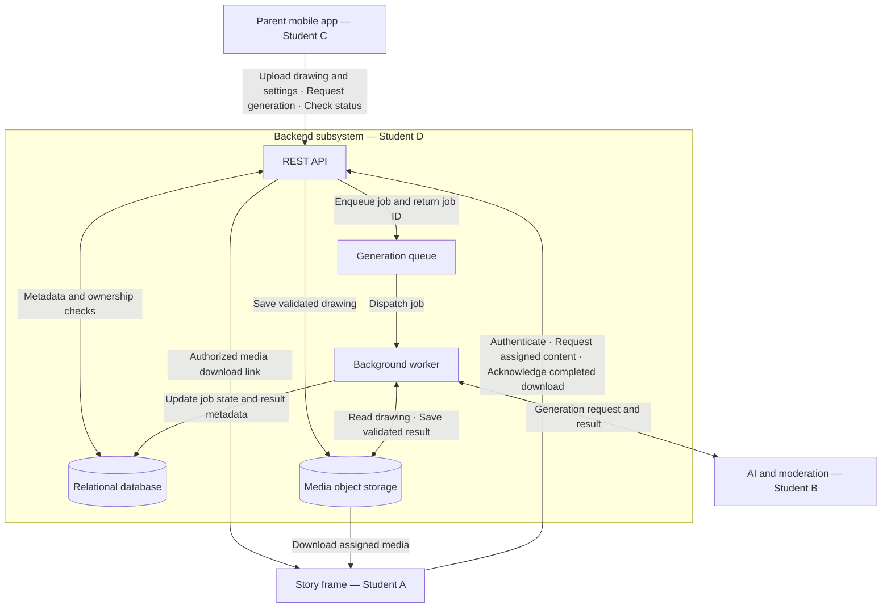

# Backend architecture

Proposed architecture for the AI-Animated Children's Story Frame. Student D owns the backend API, data and media storage design, job orchestration, and frame delivery. Stack choices remain subject to team approval.

## Proposed stack

| Component | Proposed choice |
| --- | --- |
| REST API | FastAPI |
| Database | PostgreSQL |
| Media storage | S3-compatible object storage |
| Queue | Redis with a task queue |
| Worker | Python background worker |

## Architecture notes

- The API returns a job ID immediately after queueing; slow AI generation runs in the worker.
- The database stores metadata and relationships; object storage holds image, video, and audio files.
- Parents and frames authenticate separately. The API checks ownership and frame assignments before issuing time-limited media download links.
- Generated media is available only after required validation and moderation succeed.
- Job lifecycle: `UPLOADED → QUEUED → GENERATING → MODERATING → READY → DELIVERED`. Failures enter `FAILED` with a recorded reason.
- `DELIVERED` means the assigned frame has acknowledged a successful download. It does not imply playback.
- Story text and narration generation remain an interface decision to confirm with Student B.

